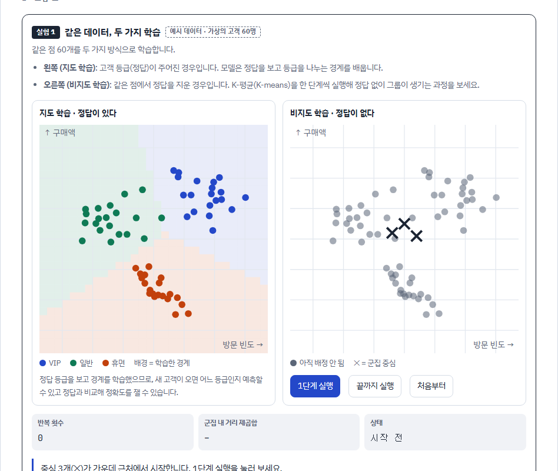

# ML·DL 스터디 노트: 브라우저에서 직접 돌려 보는 개념 실험

머신러닝·딥러닝 기반 개념을 주차별 **위클리 페이퍼**(전체 18편 예정, 현재 11편 공개)로 정리하는 곳입니다.
글로만 설명하지 않고, 값을 직접 조작하며 개념을 익힐 수 있는 **인터랙티브 실험**과 **핵심 퀴즈**를 함께 연결했습니다.
**스프린트 미션**은 [별도 목록](#스프린트-미션)에, **기초 문법 정리**는 [별도 목록](#기초-문법-정리)에 정리합니다.

| 구성 | 분량 | 특징 |
| --- | --- | --- |
| [위클리 페이퍼](#위클리-페이퍼) | 11편 공개 / 18편 예정 | 질문마다 브라우저에서 값을 바꿔 보는 인터랙티브 실험 (외부 라이브러리 없이 SVG로 구현) |
| [스프린트 미션](#스프린트-미션) | 9개 공개 / 18개 예정 | 데이터 분석 → 분류 → 객체 탐지 → 세그멘테이션 → 생성 모델 실습 노트북 |
| [기초 문법 정리](#기초-문법-정리) | 68권 (주제별 22 · 파일별 46) | Python · NumPy · Pandas부터 CNN · RNN · 생성 모델까지 수업 내용 재정리 |

👉 **웹페이지로 보기**: [https://lee-da-gyo.github.io/ml-dl-study/](https://lee-da-gyo.github.io/ml-dl-study/)

> 실험은 웹페이지에서만 동작합니다. GitHub 화면에서는 소스만 보입니다.

 위클리 페이퍼 02의 실험 화면. 버튼을 누르면 K-평균이 한 단계씩 실행된다

**처음이라면 이 3편부터** · 편별 실험 목록은 [위클리 페이퍼/README.md](위클리%20페이퍼/README.md)에 있습니다.

- **02. 편향·분산과 K-폴드**: 데이터 수를 바꾸면 분산만 줄어드는 것을 직접 측정 → [열기](https://lee-da-gyo.github.io/ml-dl-study/%EC%9C%84%ED%81%B4%EB%A6%AC%20%ED%8E%98%EC%9D%B4%ED%8D%BC/%EC%9C%84%ED%81%B4%EB%A6%AC%20%ED%8E%98%EC%9D%B4%ED%8D%BC%202.%20%EC%A7%80%EB%8F%84%C2%B7%EB%B9%84%EC%A7%80%EB%8F%84%20%C2%B7%20%EC%86%90%EC%8B%A4%20%ED%95%A8%EC%88%98%20%C2%B7%20%ED%8E%B8%ED%96%A5%C2%B7%EB%B6%84%EC%82%B0%20%C2%B7%20K-%ED%8F%B4%EB%93%9C.html)
- **08. YOLO · mAP**: IoU 기준을 바꾸면 두 모델의 순위가 뒤집히는 경우 → [열기](https://lee-da-gyo.github.io/ml-dl-study/%EC%9C%84%ED%81%B4%EB%A6%AC%20%ED%8E%98%EC%9D%B4%ED%8D%BC/%EC%9C%84%ED%81%B4%EB%A6%AC%20%ED%8E%98%EC%9D%B4%ED%8D%BC%208.%20YOLO%20%C2%B7%20mAP%20%C2%B7%20%EC%83%88%20%EC%9D%B4%EB%AF%B8%EC%A7%80%20%EC%84%B1%EB%8A%A5%20%EC%A0%80%ED%95%98%20%C2%B7%20%EC%86%8C%EA%B7%9C%EB%AA%A8%20%EC%9D%98%EB%A3%8C%20%EC%9D%B4%EB%AF%B8%EC%A7%80.html)
- **11. GAN 모드 붕괴**: 작은 GAN을 브라우저에서 학습시켜 잡는 모드 수 비교 → [열기](https://lee-da-gyo.github.io/ml-dl-study/%EC%9C%84%ED%81%B4%EB%A6%AC%20%ED%8E%98%EC%9D%B4%ED%8D%BC/%EC%9C%84%ED%81%B4%EB%A6%AC%20%ED%8E%98%EC%9D%B4%ED%8D%BC%2011.%20GAN%20%EB%AA%A8%EB%93%9C%20%EB%B6%95%EA%B4%B4%20%C2%B7%20%EC%9B%90%EC%9D%B8%20%C2%B7%20%EB%8C%80%EC%9D%91%20%C2%B7%20%ED%8F%89%EA%B0%80%20%EC%A7%80%ED%91%9C.html)

## 위클리 페이퍼

| 주차 | 주제 | 질문 | 바로 보기 |
| --- | --- | --- | --- |
| 01 | 선형대수 · EDA · 데이터 전처리 | 선형대수가 ML에 필요한 이유 / EDA란 / 결측·중복·이상치 처리 | [웹페이지에서 보기](https://lee-da-gyo.github.io/ml-dl-study/%EC%9C%84%ED%81%B4%EB%A6%AC%20%ED%8E%98%EC%9D%B4%ED%8D%BC/%EC%9C%84%ED%81%B4%EB%A6%AC%20%ED%8E%98%EC%9D%B4%ED%8D%BC%201.%20%EC%84%A0%ED%98%95%EB%8C%80%EC%88%98%20%C2%B7%20EDA%20%C2%B7%20%EB%8D%B0%EC%9D%B4%ED%84%B0%20%EC%A0%84%EC%B2%98%EB%A6%AC.html) |
| 02 | 지도·비지도 · 손실 함수 · 편향·분산 · K-폴드 | 지도와 비지도 학습의 차이 / 손실 함수 / 편향과 분산 / K-폴드의 K 선택 / 느린 반복문 개선 / 치우친 분포와 평균 / 두 팀 데이터 통합 | [웹페이지에서 보기](https://lee-da-gyo.github.io/ml-dl-study/%EC%9C%84%ED%81%B4%EB%A6%AC%20%ED%8E%98%EC%9D%B4%ED%8D%BC/%EC%9C%84%ED%81%B4%EB%A6%AC%20%ED%8E%98%EC%9D%B4%ED%8D%BC%202.%20%EC%A7%80%EB%8F%84%C2%B7%EB%B9%84%EC%A7%80%EB%8F%84%20%C2%B7%20%EC%86%90%EC%8B%A4%20%ED%95%A8%EC%88%98%20%C2%B7%20%ED%8E%B8%ED%96%A5%C2%B7%EB%B6%84%EC%82%B0%20%C2%B7%20K-%ED%8F%B4%EB%93%9C.html) |
| 03 | 결정 트리 · 부스팅 · PCA·요인 분석 | 결정 트리의 장단점 / 부스팅과 XGBoost·LightGBM·CatBoost / PCA와 요인 분석 / loss가 NaN이 될 때 / 만족도 예측: 회귀 vs 분류 | [웹페이지에서 보기](https://lee-da-gyo.github.io/ml-dl-study/%EC%9C%84%ED%81%B4%EB%A6%AC%20%ED%8E%98%EC%9D%B4%ED%8D%BC/%EC%9C%84%ED%81%B4%EB%A6%AC%20%ED%8E%98%EC%9D%B4%ED%8D%BC%203.%20%EA%B2%B0%EC%A0%95%20%ED%8A%B8%EB%A6%AC%20%C2%B7%20%EB%B6%80%EC%8A%A4%ED%8C%85%20%C2%B7%20PCA%C2%B7%EC%9A%94%EC%9D%B8%20%EB%B6%84%EC%84%9D.html) |
| 04 | 머신러닝과 딥러닝 · 하이퍼파라미터 · 과적합 진단 · 설명 가능한 모델 | 머신러닝과 딥러닝의 포함관계 / 딥러닝 하이퍼파라미터 / 훈련 99%·테스트 70% 진단 / 대출 거절 사유와 모델 선택 | [웹페이지에서 보기](https://lee-da-gyo.github.io/ml-dl-study/%EC%9C%84%ED%81%B4%EB%A6%AC%20%ED%8E%98%EC%9D%B4%ED%8D%BC/%EC%9C%84%ED%81%B4%EB%A6%AC%20%ED%8E%98%EC%9D%B4%ED%8D%BC%204.%20%EB%A8%B8%EC%8B%A0%EB%9F%AC%EB%8B%9D%EA%B3%BC%20%EB%94%A5%EB%9F%AC%EB%8B%9D%20%C2%B7%20%ED%95%98%EC%9D%B4%ED%8D%BC%ED%8C%8C%EB%9D%BC%EB%AF%B8%ED%84%B0%20%C2%B7%20%EA%B3%BC%EC%A0%81%ED%95%A9%20%EC%A7%84%EB%8B%A8%20%C2%B7%20%EC%84%A4%EB%AA%85%20%EA%B0%80%EB%8A%A5%ED%95%9C%20%EB%AA%A8%EB%8D%B8.html) |
| 05 | PyTorch·TensorFlow · 텐서 · 기울기 소실 · 배치 크기 | PyTorch와 TensorFlow 비교 / 텐서와 NumPy 배열 / 20층 시그모이드의 기울기 소실 / GPU 메모리와 배치 크기 | [웹페이지에서 보기](https://lee-da-gyo.github.io/ml-dl-study/%EC%9C%84%ED%81%B4%EB%A6%AC%20%ED%8E%98%EC%9D%B4%ED%8D%BC/%EC%9C%84%ED%81%B4%EB%A6%AC%20%ED%8E%98%EC%9D%B4%ED%8D%BC%205.%20PyTorch%C2%B7TensorFlow%20%C2%B7%20%ED%85%90%EC%84%9C%20%C2%B7%20%EA%B8%B0%EC%9A%B8%EA%B8%B0%20%EC%86%8C%EC%8B%A4%20%C2%B7%20%EB%B0%B0%EC%B9%98%20%ED%81%AC%EA%B8%B0.html) |
| 06 | CNN 레이어 · 오토인코더 · 완전연결층과 위치 변화 | CNN을 구성하는 레이어의 역할 / 오토인코더와 인코더·디코더 / 완전연결층의 파라미터 폭증과 위치 민감성 | [웹페이지에서 보기](https://lee-da-gyo.github.io/ml-dl-study/%EC%9C%84%ED%81%B4%EB%A6%AC%20%ED%8E%98%EC%9D%B4%ED%8D%BC/%EC%9C%84%ED%81%B4%EB%A6%AC%20%ED%8E%98%EC%9D%B4%ED%8D%BC%206.%20CNN%20%EB%A0%88%EC%9D%B4%EC%96%B4%20%C2%B7%20%EC%98%A4%ED%86%A0%EC%9D%B8%EC%BD%94%EB%8D%94%20%C2%B7%20%EC%99%84%EC%A0%84%EC%97%B0%EA%B2%B0%EC%B8%B5%EA%B3%BC%20%EC%9C%84%EC%B9%98%20%EB%B3%80%ED%99%94.html) |
| 07 | 리사이징·정규화 · 데이터 증강 · 전이 학습 · RNN · 오토인코더 | 이미지 리사이징과 정규화의 이유 / 데이터 증강과 이미지 증강 기법 / 전이 학습의 활용 / 긴 문장에서 RNN이 앞 단어를 잊는 이유 / 입력을 복사하는 오토인코더 | [웹페이지에서 보기](https://lee-da-gyo.github.io/ml-dl-study/%EC%9C%84%ED%81%B4%EB%A6%AC%20%ED%8E%98%EC%9D%B4%ED%8D%BC/%EC%9C%84%ED%81%B4%EB%A6%AC%20%ED%8E%98%EC%9D%B4%ED%8D%BC%207.%20%EB%A6%AC%EC%82%AC%EC%9D%B4%EC%A7%95%C2%B7%EC%A0%95%EA%B7%9C%ED%99%94%20%C2%B7%20%EB%8D%B0%EC%9D%B4%ED%84%B0%20%EC%A6%9D%EA%B0%95%20%C2%B7%20%EC%A0%84%EC%9D%B4%20%ED%95%99%EC%8A%B5%20%C2%B7%20RNN%20%C2%B7%20%EC%98%A4%ED%86%A0%EC%9D%B8%EC%BD%94%EB%8D%94.html) |
| 08 | YOLO · mAP · 새 이미지 성능 저하 · 소규모 의료 이미지 | YOLO의 특징과 장점 / mAP의 개념과 활용 / 학습 정확도는 높은데 새 이미지에서 성능 저하 / 의료 이미지 300장으로 처음부터 학습 | [웹페이지에서 보기](https://lee-da-gyo.github.io/ml-dl-study/%EC%9C%84%ED%81%B4%EB%A6%AC%20%ED%8E%98%EC%9D%B4%ED%8D%BC/%EC%9C%84%ED%81%B4%EB%A6%AC%20%ED%8E%98%EC%9D%B4%ED%8D%BC%208.%20YOLO%20%C2%B7%20mAP%20%C2%B7%20%EC%83%88%20%EC%9D%B4%EB%AF%B8%EC%A7%80%20%EC%84%B1%EB%8A%A5%20%EC%A0%80%ED%95%98%20%C2%B7%20%EC%86%8C%EA%B7%9C%EB%AA%A8%20%EC%9D%98%EB%A3%8C%20%EC%9D%B4%EB%AF%B8%EC%A7%80.html) |
| 09 | Semantic Segmentation · FCN · GAN · Diffusion · 객체 탐지 | Semantic Segmentation과 이미지 분류 / FCN과 분류 CNN의 차이 / GAN의 생성자와 판별자 / Diffusion 모델의 활용과 장점 / CCTV 진열대 상품의 개수와 위치 | [웹페이지에서 보기](https://lee-da-gyo.github.io/ml-dl-study/%EC%9C%84%ED%81%B4%EB%A6%AC%20%ED%8E%98%EC%9D%B4%ED%8D%BC/%EC%9C%84%ED%81%B4%EB%A6%AC%20%ED%8E%98%EC%9D%B4%ED%8D%BC%209.%20Semantic%20Segmentation%20%C2%B7%20FCN%20%C2%B7%20GAN%20%C2%B7%20Diffusion%20%C2%B7%20%EA%B0%9D%EC%B2%B4%20%ED%83%90%EC%A7%80.html) |
| 10 | Semantic·Instance Segmentation · Panoptic · 객체 추적 | 자율주행 영상에서 픽셀의 클래스 구분과 차량 개체 구별 | [웹페이지에서 보기](https://lee-da-gyo.github.io/ml-dl-study/%EC%9C%84%ED%81%B4%EB%A6%AC%20%ED%8E%98%EC%9D%B4%ED%8D%BC/%EC%9C%84%ED%81%B4%EB%A6%AC%20%ED%8E%98%EC%9D%B4%ED%8D%BC%2010.%20Semantic%C2%B7Instance%20Segmentation%20%C2%B7%20Panoptic%20%C2%B7%20%EA%B0%9D%EC%B2%B4%20%EC%B6%94%EC%A0%81.html) |
| 11 | GAN 모드 붕괴 · 원인 · 대응 · 평가 지표 | 학습할수록 비슷한 얼굴만 만드는 GAN의 모드 붕괴: 원인과 대응 | [웹페이지에서 보기](https://lee-da-gyo.github.io/ml-dl-study/%EC%9C%84%ED%81%B4%EB%A6%AC%20%ED%8E%98%EC%9D%B4%ED%8D%BC/%EC%9C%84%ED%81%B4%EB%A6%AC%20%ED%8E%98%EC%9D%B4%ED%8D%BC%2011.%20GAN%20%EB%AA%A8%EB%93%9C%20%EB%B6%95%EA%B4%B4%20%C2%B7%20%EC%9B%90%EC%9D%B8%20%C2%B7%20%EB%8C%80%EC%9D%91%20%C2%B7%20%ED%8F%89%EA%B0%80%20%EC%A7%80%ED%91%9C.html) |

## 스프린트 미션

전체 18개 예정, 현재 9개 공개 · [전체 목록](스프린트%20미션)

| 미션 | 바로 보기 |
| --- | --- |
| 미션 1_Python 연습 | [제출본](스프린트%20미션/미션%201_Python%20연습/미션%201_Python%20연습_제출본.ipynb) · [교재](스프린트%20미션/미션%201_Python%20연습/미션%201_Python%20연습_교재.ipynb) |
| 미션 2_호텔 예약 취소 분석 | [노트북](스프린트%20미션/미션%202_호텔%20예약%20취소%20분석/미션%202_호텔%20예약%20취소%20분석.ipynb) |
| 미션 3_타이타닉 생존 예측 | [노트북](스프린트%20미션/미션%203_타이타닉%20생존%20예측/미션%203_타이타닉%20생존%20예측.ipynb) |
| 미션 4_PyTorch 기초 | [노트북](스프린트%20미션/미션%204_PyTorch%20기초/미션%204_PyTorch%20기초.ipynb) |
| 미션 5_오토인코더 문서 복원과 이상 탐지 | [노트북](스프린트%20미션/미션%205_오토인코더%20문서%20복원과%20이상%20탐지/미션%205_오토인코더%20문서%20복원과%20이상%20탐지.ipynb) |
| 미션 6_흉부 X-ray 폐렴 분류 | [노트북](스프린트%20미션/미션%206_흉부%20X-ray%20폐렴%20분류/미션%206_흉부%20X-ray%20폐렴%20분류.ipynb) |
| 미션 7_반려동물 얼굴 객체 탐지 | [노트북](스프린트%20미션/미션%207_반려동물%20얼굴%20객체%20탐지/미션%207_반려동물%20얼굴%20객체%20탐지.ipynb) |
| 미션 8_축구 경기 이미지 세그멘테이션 | [노트북](스프린트%20미션/미션%208_축구%20경기%20이미지%20세그멘테이션/미션%208_축구%20경기%20이미지%20세그멘테이션.ipynb) |
| 미션 9_cGAN 패션 이미지 생성 | [노트북](스프린트%20미션/미션%209_cGAN%20패션%20이미지%20생성/미션%209_cGAN%20패션%20이미지%20생성.ipynb) |

## 기초 문법 정리

딥러닝 코드를 읽기 위한 기초 문법 · 모두 68권 (주제별 정리 22권 + 원본 파일별 정리 46권) · 아래는 주제별 대표 노트북 (통계 · 시각화는 파일별 정리) · [전체 목록과 읽는 순서](기초%20문법%20정리)

| 정리 | 바로 보기 |
| --- | --- |
| 01_Python 문법 | [노트북](기초%20문법%20정리/01_Python%20문법/Python%20문법_전체%20정리.ipynb) |
| 02_Python 클래스 | [노트북](기초%20문법%20정리/02_Python%20클래스/Python%20클래스_전체%20정리.ipynb) |
| 03_NumPy | [노트북](기초%20문법%20정리/03_NumPy/NumPy_전체%20정리.ipynb) |
| 04_Pandas | [노트북](기초%20문법%20정리/04_Pandas/Pandas_전체%20정리.ipynb) |
| 04_통계·시각화 (파일별 정리) | [노트북](기초%20문법%20정리/04_통계·시각화/통계_파일별%201_02_데이터%20요약과%20시각화.ipynb) |
| 05_머신러닝 -1 데이터 분할 · 교차검증 | [노트북](기초%20문법%20정리/05_머신러닝/머신러닝-1_데이터분할·교차검증%28완성본%29.ipynb) |
| 05_머신러닝 -2 전처리 · 누수 · 파이프라인 | [노트북](기초%20문법%20정리/05_머신러닝/머신러닝-2_전처리·누수·파이프라인%28완성본%29.ipynb) |
| 05_머신러닝 -3 평가지표 · 로지스틱 | [노트북](기초%20문법%20정리/05_머신러닝/머신러닝-3_평가지표·로지스틱%28완성본%29.ipynb) |
| 06_딥러닝기초 · PyTorch -1 텐서 · 경사하강 | [노트북](기초%20문법%20정리/06_딥러닝기초·PyTorch/딥러닝기초-1_텐서·경사하강%28완성본%29.ipynb) |
| 07_CNN -1 합성곱 · 크기 계산 | [노트북](기초%20문법%20정리/07_CNN/CNN-1_합성곱·크기계산%28완성본%29.ipynb) |
| 07_CNN -2 풀링 · 구조 · ResNet | [노트북](기초%20문법%20정리/07_CNN/CNN-2_풀링·구조·ResNet%28완성본%29.ipynb) |
| 08_RNN -1 순서 데이터 · RNN · LSTM · GRU | [노트북](기초%20문법%20정리/08_RNN/RNN-1_순서데이터·RNN·LSTM·GRU%28완성본%29.ipynb) |
| 08_RNN -2 시계열 예측 | [노트북](기초%20문법%20정리/08_RNN/RNN-2_시계열예측%28완성본%29.ipynb) |
| 08_RNN -3 텍스트 · 임베딩 | [노트북](기초%20문법%20정리/08_RNN/RNN-3_텍스트·임베딩%28완성본%29.ipynb) |
| 09_오토인코더 -1 압축 · 복원 · Conv 오토인코더 | [노트북](기초%20문법%20정리/09_오토인코더/오토인코더-1_압축·복원·ConvAE%28완성본%29.ipynb) |
| 09_오토인코더 -2 노이즈 제거 · 평가 · 이상 탐지 | [노트북](기초%20문법%20정리/09_오토인코더/오토인코더-2_노이즈제거·평가·이상탐지%28완성본%29.ipynb) |
| 11_객체탐지 -1 박스 · IoU · NMS · 채점 | [노트북](기초%20문법%20정리/11_객체탐지/객체탐지-1_박스·IoU·NMS·채점%28완성본%29.ipynb) |
| 11_객체탐지 -2 학습 · 평가 · 오류 분석 | [노트북](기초%20문법%20정리/11_객체탐지/객체탐지-2_학습·평가·오류분석%28완성본%29.ipynb) |
| 11_객체탐지 -3 모델 비교 · YOLO 실전 | [노트북](기초%20문법%20정리/11_객체탐지/객체탐지-3_모델비교·YOLO실전%28완성본%29.ipynb) |
| 12_세그멘테이션 -1 픽셀 분류 · U-Net | [노트북](기초%20문법%20정리/12_세그멘테이션/세그멘테이션-1_픽셀분류·U-Net%28완성본%29.ipynb) |
| 12_세그멘테이션 -2 실전 · 사전학습 · Instance | [노트북](기초%20문법%20정리/12_세그멘테이션/세그멘테이션-2_실전·사전학습·Instance%28완성본%29.ipynb) |
| 13_생성모델 -1 GAN · Diffusion | [노트북](기초%20문법%20정리/13_생성모델/생성모델-1_GAN·Diffusion%28완성본%29.ipynb) |
| 13_생성모델 -2 cGAN · 생성 평가 | [노트북](기초%20문법%20정리/13_생성모델/생성모델-2_cGAN·생성평가%28완성본%29.ipynb) |

## 구성

- 질문마다 **한 줄 요약 → 실험 → 핵심 분석 → Q&A 및 도움말 → 요약**
- 모든 통계 구성 요소는 웹페이지에서 직접 계산됩니다.
- 설명용 가상 데이터에는 `예시`, 출처가 있는 데이터에는 `실제 데이터` 표시

## 기술 스택

- HTML · CSS · JavaScript (외부 라이브러리 없이 SVG로 차트와 실험 구현)
- 라이트/다크 모드 지원, 모바일 반응형 디자인
- GitHub Pages 배포

## 데이터 출처

| 파일 | 출처 |
| --- | --- |
| `스프린트 미션/미션 2_호텔 예약 취소 분석/hotel_data_modified.csv.gz` | 코드잇 AI 스프린트 미션 제공 데이터 (원본을 과제용으로 수정한 파일, gzip 압축 · `pd.read_csv`가 그대로 읽음) |
| `스프린트 미션/미션 3_타이타닉 생존 예측/titanic_train.csv` | Kaggle [Titanic - Machine Learning from Disaster](https://www.kaggle.com/c/titanic) 학습 데이터 (스프린트 미션 제공) |

노트북을 다시 실행할 수 있도록 미션 데이터를 함께 두었습니다. 데이터의 권리는 각 제공처에 있으며 이용 조건도 제공처를 따릅니다.
미션 5~9의 데이터(Kaggle · torchvision)는 용량 때문에 저장소에 넣지 않았고, 각 노트북 앞부분에 출처와 받는 방법을 적었습니다.

## 라이선스

- 위클리 페이퍼(`위클리 페이퍼/`, `index.html`)의 코드와 글은 [MIT License](LICENSE)를 따릅니다.
- 스프린트 미션과 기초 문법 정리는 코드잇 AI 스프린트 15기 수업 자료와 과제를 바탕으로 한 학습 기록입니다. 원 자료의 권리는 코드잇에 있어 MIT License 대상이 아닙니다.
